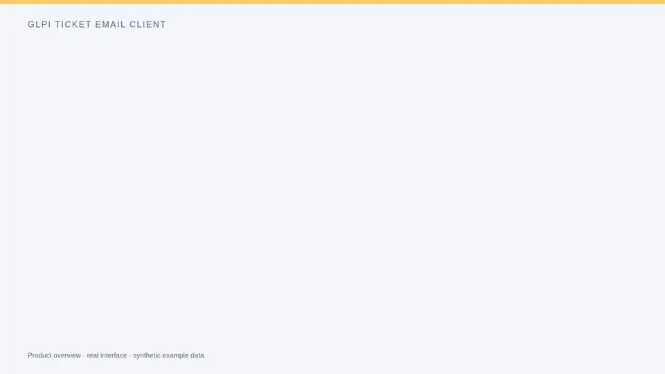
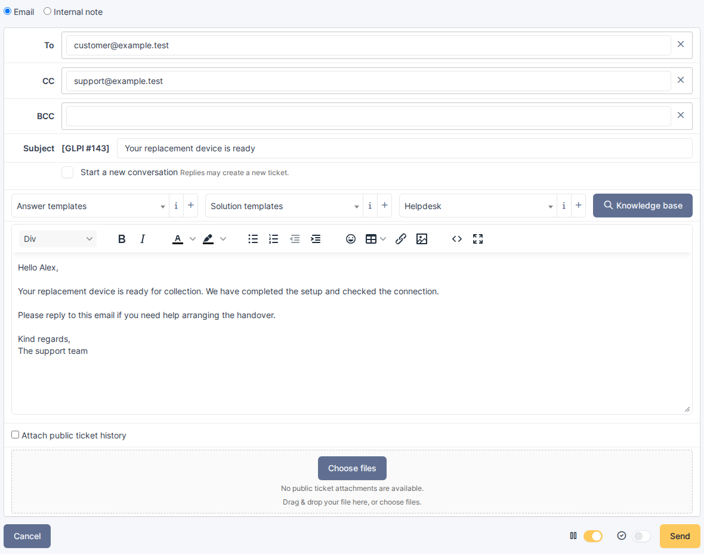

# GLPI Ticket Email Client

**Write the email. Keep the context. Stay in GLPI.**

Give your GLPI support team a ticket-based email composer with **To, CC, BCC, rich text, and attachments**. Send through your existing GLPI SMTP settings and keep the outbound message in the ticket timeline and a durable send log.

  

*16-second animated overview using the current interface and synthetic data, not a continuous send recording. [Watch or download the MP4](assets/readme/ticketmailer-teaser.mp4).*

[Install the plugin](docs/INSTALLATION.md#installation) · [User guide](docs/wiki/User-Guide-EN.md) · [Deutsches Handbuch](docs/wiki/Benutzerhandbuch-DE.md) · [Releases](https://github.com/rgruenewald/glpi-ticket-email-client/releases)

## Why Ticketmailer?

A ticket reply often needs more than a notification: the right recipients, a clear subject, supporting files, and a record the next agent can follow. Ticketmailer brings that email workflow into the ticket itself.

- **Control the conversation.** Edit To, CC, BCC, and the subject instead of relying on notification recipients. Requesters default to To and observers to CC; assignees are not added automatically.
- **Keep the handover in the ticket.** A successful send becomes a standard GLPI timeline followup with the outbound content and secure attachment links. The audit log records send attempts and their outcomes.
- **Use the mail setup you already run.** Email goes through GLPI's configured SMTP transport, not the notification engine. The email's timeline followup does not trigger a second notification email.

## From ticket to email

Open a ticket, select **Email reply**, check the recipients, and write your message. Attach the files the recipient needs, then send. The message stays with the ticket so another agent can pick up the conversation.

  

*Current email composer, captured locally with synthetic example data. See the [user guide](docs/wiki/User-Guide-EN.md) for everyday usage.*

## Key features

- **A full email composer:** GLPI's built-in rich-text editor, inline images, normal attachments, and To/CC/BCC, including BCC-only messages.
- **Relevant ticket context:** optionally append public ticket history and select attachments from the ticket or public followups. Private followups and their documents are never offered or sent.
- **Start a conversation, too:** use **Assistance → New email** to create a ticket and send a proactive message in one workflow.
- **Email or internal note:** choose Email by default, or switch to GLPI's native private-followup form for an internal note. GLPI's configured native followup notifications remain unchanged.
- **Ticket-aware subjects:** keep the ticket routing marker, or explicitly start a new conversation with a warning that replies may create a new ticket.
- **Fit your team's workflow:** entity-specific ticket templates, entity/profile reply policies, and English and German interfaces.
- **Visible delivery outcomes:** a durable audit intent before SMTP, one send attempt, and distinct SMTP and timeline outcomes. No automatic resend.

## Before you install: security and privacy

- **BCC is not private within GLPI. Every ticket reader can see the full BCC list** in the timeline and audit detail. BCC recipients are excluded from the email's visible To/CC headers.
- Only ticket readers can view the send log, message details, and stored attachments. Composing and sending require ticket update or followup rights.
- A matching GLPI mail collector address triggers a warning and requires an explicit override. This guard is best effort: aliases, forwarding, and non-email collector logins are not detected.
- Each email gets exactly one SMTP attempt, with no automatic retry. If SMTP succeeds but the timeline followup fails, the result is **incomplete**, not a full success. **Do not resend:** the email has already been sent.

## Get started

**Supported:** GLPI 11.0.x · PHP 8.2+ · verified against GLPI 11.0.8.

1. Download a [release](https://github.com/rgruenewald/glpi-ticket-email-client/releases) and place the plugin in `<glpi-root>/plugins/ticketmailer`.
2. Install and enable `ticketmailer` through GLPI's plugin administration or CLI.
3. Check GLPI's SMTP configuration, open a ticket, and select **Email reply**.

Read the **[installation and administration guide](docs/INSTALLATION.md)** for prerequisites, CLI commands, upgrades, configuration, delivery outcomes, and development checks.

Ticketmailer is an outbound composer, not a mailbox: it has no inbound processing, IMAP sync, queue, automatic retries, or persistent draft storage. It adds no SMTP configuration of its own. Marketplace listing and acceptance have not been verified.

## Documentation

- [English user guide](docs/wiki/User-Guide-EN.md) · [Deutsches Handbuch](docs/wiki/Benutzerhandbuch-DE.md)
- [Installation and administration](docs/INSTALLATION.md)
- [Local development and end-to-end verification](docs/verification/docker-e2e.md)

## Contributing and security

Bug reports and contributions are welcome. When [opening an issue](https://github.com/rgruenewald/glpi-ticket-email-client/issues), include your GLPI/PHP versions, reproduction steps, and redacted errors. Never include SMTP credentials, real recipient lists, or private ticket content.

See [CONTRIBUTING.md](CONTRIBUTING.md) for development and contribution rules. See [SECURITY.md](SECURITY.md) for vulnerability reporting.

## License

Copyright © Ronny Gruenewald.

Licensed under the [GNU General Public License, version 3 or later](LICENSE).
