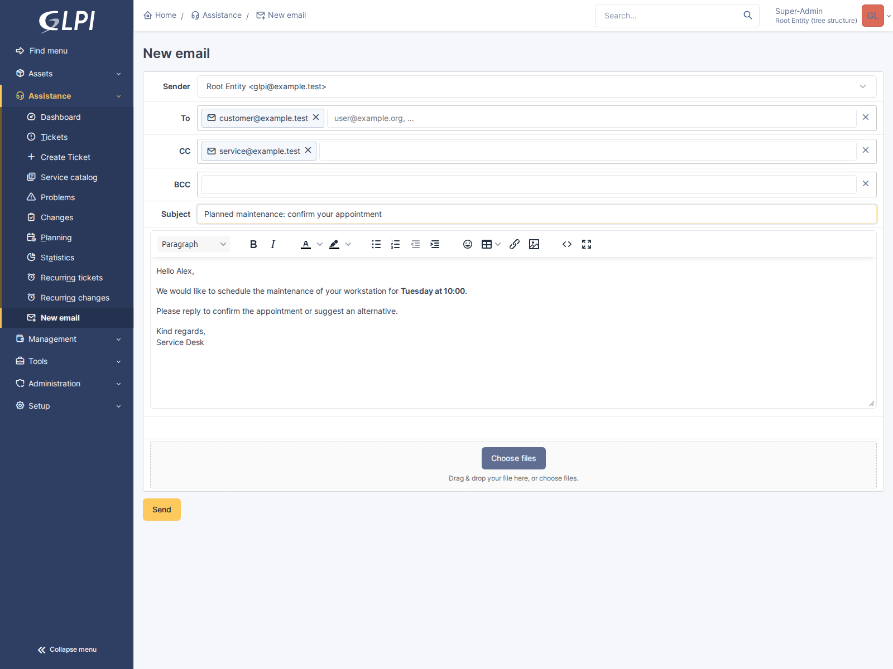
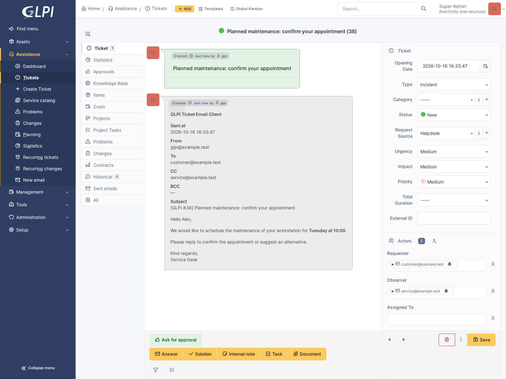

# New email: GLPI 11 runtime screenshots

Captured from the isolated local GLPI 11.0.8 test instance after integrating main into PR #29. All addresses and message content are synthetic. SMTP delivery goes only to the local Mailpit sink.

## Compose before a ticket exists

Assistance > New email, with To, CC, subject and message filled in. Sending creates the ticket; cancelling does not.

## Created ticket and outbound message

After Send: the subject becomes the ticket title, To becomes Requester, CC becomes Observer, and the outbound message appears in the timeline with the new ticket marker.

## Capture and layout regression check

Run `NODE_PATH=/path/to/node_modules node docs/pr/29/capture.cjs` against the isolated GLPI test instance. Optional environment variables: GLPI_TEST_URL, GLPI_TEST_USER, GLPI_TEST_PASSWORD. This creates a synthetic ticket and sends to the test SMTP sink, so never target production.

Use a fixed 1600 x 1200 viewport, normal zoom, viewport-only screenshots and disabled animations. The script checks both ticket columns and document width before and after capture.

The previous full-page capture reproduced a screenshot-induced GLPI layout defect: a 1440px viewport had no overflow before capture, but document width grew to about 1910px immediately afterward. GLPI uses animated, viewport-height-dependent flex columns. Full-page screenshot resizing perturbs that layout; it settles back after the capture. CSS zoom and further resizing magnified the artifact. No plugin or GLPI CSS override is necessary for this verified capture issue.
